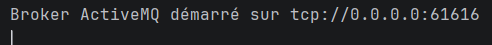
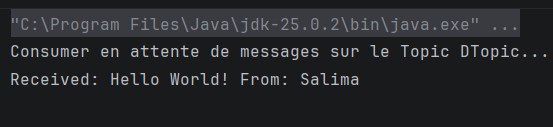
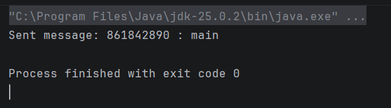
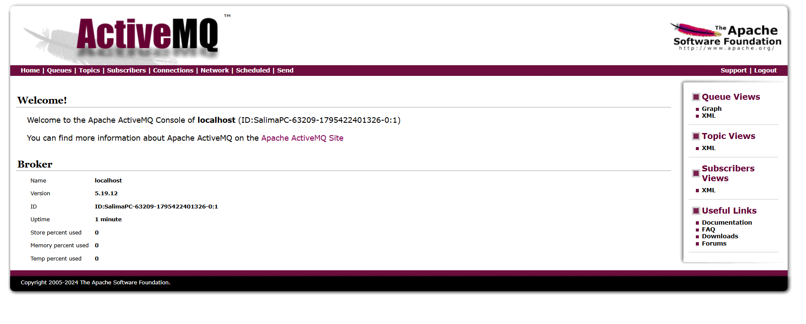
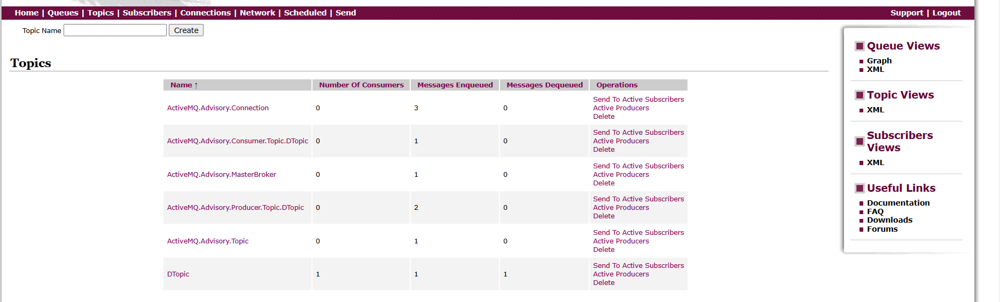
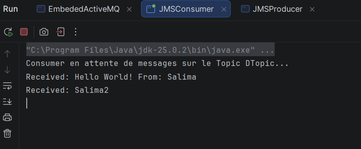
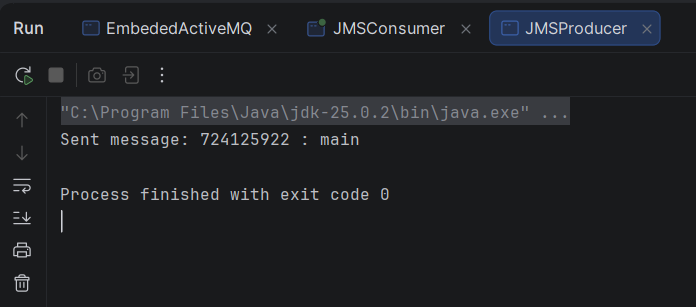

# TP7 — Système distribué asynchrone : JMS avec ActiveMQ

**Matière :** Développement d’applications réparties  
**Formation :** LSI 3 — Faculté des Sciences de Sfax  
**Année universitaire :** 2026–2027  
**Réalisé par :** Salima Fourati

## 1. Présentation

Ce TP met en œuvre une communication asynchrone entre un producteur et un consommateur Java grâce à **JMS (Java Message Service)** et au broker **Apache ActiveMQ Classic**. Le producteur publie un message sur un **Topic** nommé `DTopic` et le consommateur abonné le reçoit via un `MessageListener`.

## 2. Objectifs

- Configurer un projet Java Maven avec les dépendances ActiveMQ.
- Démarrer un broker ActiveMQ embarqué dans une application Java.
- Publier un message texte avec un producteur JMS.
- Recevoir des messages de manière asynchrone avec un consommateur JMS.
- Vérifier le fonctionnement à l’aide des consoles Java et de l’interface d’administration ActiveMQ.

## 3. Environnement technique

| Élément | Version / configuration |
|---|---|
| Langage | Java 25 (JDK 25.0.2 utilisé lors des tests) |
| IDE | IntelliJ IDEA |
| Gestion des dépendances | Maven |
| `activemq-client` et `activemq-broker` (pom.xml) | 5.19.1 |
| Serveur ActiveMQ Classic observé dans la console web | 5.19.12 |
| `slf4j-simple` | 2.0.9 |
| Protocole et port | TCP / 61616 |
| Destination | Topic `DTopic` |

> **Remarque :** les dépendances Maven déclarent ActiveMQ 5.19.1, tandis que la console web présentée dans les captures indique un serveur ActiveMQ 5.19.12. Ces versions sont rapportées telles qu'utilisées ou observées, sans les confondre.

## 4. Organisation du projet

```text
TP7_JMS/
├── pom.xml
├── README.md
├── screenshots/
│   ├── 01_broker_demarre.png
│   ├── 02_consumer_reception.png
│   ├── 03_producer_execution.png
│   ├── 04_console_activemq.png
│   ├── 05_topic_dtopic.png
│   ├── 06_consumer_deux_messages.png
│   └── 07_producer_second_test.png
└── src/
    └── main/
        └── java/
            └── jms/
                ├── EmbededActiveMQ.java
                ├── JMSConsumer.java
                └── JMSProducer.java
```

## 5. Architecture de communication

```text
JMSProducer ── publie TextMessage ──► ActiveMQ Broker
                                           │
                                           ▼
                                      Topic DTopic
                                           │
                                           ▼
                               JMSConsumer (MessageListener)
```

Le broker assure l’acheminement des messages. Le producteur et le consommateur n’ont pas besoin de communiquer directement. Dans ce TP, le consommateur doit être abonné avant l’envoi pour recevoir les messages non persistants publiés sur ce Topic.

## 6. Implémentation

### 6.1. Configuration Maven (`pom.xml`)

Le fichier `pom.xml` déclare `activemq-client` pour l’API JMS et la connexion au broker, `activemq-broker` pour le broker embarqué et `slf4j-simple` pour la journalisation. Le compilateur est configuré pour Java 25.

### 6.2. Broker embarqué (`EmbededActiveMQ.java`)

La classe crée un `BrokerService`, désactive la persistance avec `setPersistent(false)`, ajoute le connecteur `tcp://0.0.0.0:61616`, puis lance le broker avec `start()`. La méthode `waitUntilStopped()` maintient le broker en fonctionnement.

**Capture 1 — Démarrage du broker :**



Le terminal confirme que le broker écoute sur le port 61616.

### 6.3. Consommateur (`JMSConsumer.java`)

Le consommateur utilise `ActiveMQConnectionFactory` pour se connecter à `tcp://localhost:61616`. Il crée une session non transactionnelle avec `Session.AUTO_ACKNOWLEDGE`, s’abonne à `DTopic`, puis installe un `MessageListener`. Sa méthode `onMessage()` affiche le texte des `TextMessage` reçus.

**Capture 2 — Réception d’un premier message :**



La console affiche `Received: Hello World! From: Salima`, ce qui confirme la réception asynchrone.

### 6.4. Producteur (`JMSProducer.java`)

Le producteur se connecte au broker, crée une session transactionnelle avec `createSession(true, Session.AUTO_ACKNOWLEDGE)` et publie un `TextMessage` sur `DTopic`. Il utilise `DeliveryMode.NON_PERSISTENT`. L’appel `session.commit()` valide l’envoi avant la fermeture de la session et de la connexion.

Le contenu du message est construit à partir de `NOM_EXPEDITEUR = "Salima"` :

```text
Hello World! From: Salima
```

**Capture 3 — Exécution du producteur :**



La console affiche `Sent message: ... : main` et `Process finished with exit code 0`. Le nombre affiché provient de `message.hashCode()` ; ce n’est pas le contenu du message envoyé.

## 7. Exécution et vérification

1. Exécuter `EmbededActiveMQ.java` pour lancer le broker embarqué.
2. Exécuter `JMSConsumer.java` et le laisser à l’écoute de `DTopic`.
3. Exécuter `JMSProducer.java` pour publier le message.
4. Vérifier la réception dans la console du consommateur.
5. Consulter, si un serveur ActiveMQ avec console web est démarré, son interface d’administration pour observer les Topics. **Éviter de démarrer deux brokers sur le port 61616 simultanément.** La console web n’est pas automatiquement fournie par le broker embarqué de cette classe Java.

### 7.1. Console d’administration ActiveMQ

**Capture 4 — Tableau de bord ActiveMQ Classic :**



Cette capture montre le broker `localhost` et la version `5.19.12` dans l’interface d’administration.

### 7.2. Vérification du Topic

**Capture 5 — Topic `DTopic` :**



Le tableau affiche le Topic `DTopic`, avec **1 consommateur**, **1 message enqueued** et **1 message dequeued** au moment de la capture. Les autres lignes `ActiveMQ.Advisory.*` sont des Topics internes de supervision.

### 7.3. Tests complémentaires

**Capture 6 — Deux messages reçus :**



Le consommateur affiche successivement `Received: Hello World! From: Salima` et `Received: Salima2`. Le deuxième message est observé dans la capture ; le code du producteur fourni construit quant à lui le premier message.

**Capture 7 — Nouvelle exécution du producteur :**



Le producteur affiche une nouvelle ligne `Sent message: ... : main`, puis se termine normalement avec `exit code 0`.

## 8. Résultats

Les tests montrent que :

- Le broker Java démarre sur le port TCP 61616.
- Le producteur termine son exécution sans erreur visible.
- Le consommateur reçoit et affiche des messages publiés sur `DTopic`.
- Le `MessageListener` permet une réception asynchrone.
- L’interface ActiveMQ montre l’existence du Topic et des statistiques d’échange lors du test illustré.

## 9. Conclusion

Ce TP a permis de mettre en pratique une architecture de messagerie distribuée asynchrone avec JMS et ActiveMQ. La séparation entre producteur, broker et consommateur facilite le découplage des applications. Les tests confirment l’envoi et la réception des messages sur un Topic, ainsi que l’utilisation d’un listener pour traiter les messages dès leur arrivée.
